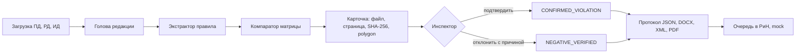

<p align="center">
  
</p>

<p align="center">
  <a href="https://github.com/KonkovDV/Kontur/raw/main/submission/03-presentation/Kontur.pptx"></a>
  <a href="https://github.com/KonkovDV/Kontur/blob/main/submission/03-presentation/Kontur.pdf"></a>
</p>

<p align="center">
  <a href="https://github.com/KonkovDV/Kontur/actions/workflows/ci.yml"></a>
  
  <a href="docker-compose.offline.yml"></a>
  <a href="contracts/openapi.yaml"></a>
  
  <a href="LICENSE"></a>
  <a href="docs/METRICS.md"></a>
</p>

# Контур — «Инспектор ИИ»

Сервис камеральной сверки проектной (ПД), рабочей (РД) и исполнительной (ИД)
документации по матрице из 132 контролируемых параметров. Заказчик —
Мосгосстройнадзор.

Контур находит расхождение между стадиями и кладёт на карточку файл, страницу,
SHA-256 и область на листе. Решение по карточке принимает инспектор. Стенд
работает локально: документы не уходят во внешние LLM, OCR и VLM.

Код открыт под лицензией [MIT](LICENSE).

**Документы:** [пакет поставки](submission/README.md) ·
[досье](submission/02-documentation/README.md) ·
[протокол запуска](submission/04-prototype/README.md) ·
[реестр доказательств](submission/05-additional/README.md) ·
[пример JSON](submission/05-additional/examples/README.md) ·
[карта документов](docs/README.md)

## Содержание

- [Состояние](#состояние)
- [Куда смотреть](#куда-смотреть)
- [Задача заказчика](#задача-заказчика)
- [Как устроено](#как-устроено)
- [Редакция, штамп и знак триггера](#редакция-штамп-и-знак-триггера)
- [Слова на экране](#слова-на-экране)
- [Почему так: практика и исследования](#почему-так-практика-и-исследования)
- [Быстрый старт](#быстрый-старт)
- [Сценарий на учебном комплекте](#сценарий-на-учебном-комплекте)
- [Пакетный прогон и счёт](#пакетный-прогон-и-счёт)
- [Что есть и что дальше](#что-есть-и-что-дальше)
- [Метрики](#метрики)
- [Приёмка и где её проверить](#приёмка-и-где-её-проверить)
- [Требования ТЗ и где их след](#требования-тз-и-где-их-след)
- [Границы, которые не нарушаются](#границы-которые-не-нарушаются)
- [Качество и безопасность](#качество-и-безопасность)
- [Разработка](#разработка)
- [Стек](#стек)
- [Карта репозитория](#карта-репозитория)
- [Документы](#документы)
- [Лицензия](#лицензия)

## Состояние

Срез 20.10.2026. Источники чисел — [`TZ_SCORECARD.md`](docs/TZ_SCORECARD.md)
и [`METRICS.md`](docs/METRICS.md).

| Что | Сейчас |
|---|---|
| Стенд | Поднимается одной командой и из офлайн-tar. Учебный комплект доходит до финализированного протокола |
| Матрица | Рабочий экстрактор у 59 правил из 132. Ещё 68 ждут экстрактора, 4 смотрят во внешний источник, 1 справочное |
| Публичный gold Тюменской, 08.10 | Матрица 6 из 6, свободный поиск 4 из 4. Нижние границы Wilson 0,61 и 0,51 ниже порога полноты 0,80 |
| OCR на SILVER, 26.09 | Нижняя граница доли строк с CA не ниже 0,95 — 0,663 при пороге 0,95 |
| Приёмка | Гейты I, J, K и L впереди: нет frozen validation, пяти сессий инспекторов и живого РиН |

Цепочка редакции по имени файла (15.10) и чтение штампа с первого листа
(18.10) в эти счёты не входили.

## Куда смотреть

1. Стенд — [быстрый старт](#быстрый-старт), затем http://127.0.0.1:3000.
2. Учебный комплект — [сценарий](#сценарий-на-учебном-комплекте): эталон, три кандидата, протокол, очередь в РиН.
3. Замеры — [метрики](#метрики), [реестр доказательств](submission/05-additional/README.md) и [`METRICS.md`](docs/METRICS.md).
4. Пункт ТЗ — [трассируемость](docs/TZ_TRACEABILITY.md).

Карта всех документов по типу вопроса — [`docs/README.md`](docs/README.md).

## Задача заказчика

Инспектор получает комплект томов трёх стадий и сверяет их вручную: площадь
застройки в ПД и в РД, класс бетона, ширину проёма, сечение воздуховода.
Параметров 132, томов десятки, у тома бывает несколько редакций, часть листов —
скан без текстового слоя. Ошибка на этом пути бывает двух видов: пропущенное
расхождение и «нарушение», которое на деле вызвано неполным комплектом или
чужой редакцией.

Контур забирает на себя поиск по томам:

1. Находит голову редакции тома. Шифр штампа важнее имени файла. Если штамп
   шифра не дал, цепочку ПД и РД собирает имя без метки редакции.
2. Достаёт значение параметра из текстового слоя страницы. Если слоя нет —
   распознаёт страницу локально.
3. Сравнивает значения стадий по правилу матрицы и собирает доказательство.

Подпись под нарушением ставит инспектор. Пустая стадия получает статус
`MISSING_EVIDENCE`. Непрочитанное значение получает `ABSTAIN` или `LOW_QUALITY`.

Единица результата — точка `object_id + parameter_code + location`
([ответ заказчика 14](docs/ORGANIZER_ANSWERS_2026_09_26.md)). Сверяются ПД, РД
и ИД между собой ([ADR-0006](docs/adr/0006-compare-documents-not-norms.md)).

## Как устроено



| Шаг | Что делает | Решение |
|---|---|---|
| Редакция | Цепочка внутри шифра. Пустой шифр чужой том не прячет. Имя файла собирает цепочку только без шифра штампа | [ADR-0003](docs/adr/0003-revision-resolver-before-comparison.md), [ADR-0017](docs/adr/0017-sole-head-without-stamp.md) |
| Извлечение | Сначала вектор страницы через pdfium, координаты после CropBox, MediaBox и Rotate. Пустой слой — локальный OCR: eslav PP-OCRv5, затем Tesseract. DOCX — абзацы и таблицы | [`OCR_BAKEOFF.md`](docs/OCR_BAKEOFF.md) |
| Правило | 132 параметра лежат данными в [`data/matrix/`](data/matrix/), не кодом. Правило без экстрактора остаётся `extractor_missing` и нарушения не выдаёт | [ADR-0004](docs/adr/0004-rules-are-data.md) |
| Вердикт | Допуск, округление, лестница классов, знак триггера. Разность десятичная. Модель не пишет `finding_status` | [ADR-0001](docs/adr/0001-llm-never-sets-verdict.md) |
| Доказательство | Предметная находка не сохраняется без `evidence_group_id`, SHA-256 источника, страницы и polygon | [ADR-0002](docs/adr/0002-evidence-group-is-the-unit.md) |
| Решение | Автомат останавливается на `CANDIDATE`. `CONFIRMED_VIOLATION` пишет только инспектор. Отклонение требует причины. Каждое решение — запись аудита с автором | [ADR-0005](docs/adr/0005-status-domains-are-separate.md) |
| Протокол | Материализуется атомарно с версией. В РиН уходит через outbox. Подтверждение брокера — не ACK РиН | [ADR-0009](docs/adr/0009-atomic-protocol-materialization.md), [ADR-0010](docs/adr/0010-outbox-relay-to-broker.md) |

Контейнеры стенда, их связи и порты — [`ARCHITECTURE.md`](docs/ARCHITECTURE.md#контейнеры-стенда).

## Редакция, штамп и знак триггера

- Шифр в основной надписи важнее имени файла. На большом листе надпись
  берётся из правого нижнего угла 190×70 мм видимой страницы первого листа с
  учётом `/Rotate`: шифр комплекта, графа «Лист» и буква стадии П, Р или И.
- Пустой шифр собирает ПД и РД одного имени в одну цепочку: `КР1.pdf` и
  `КР1-кор3.pdf` — один том, голова — больший номер. Один номер у двух разных
  файлов — `CLARIFICATION_REQUIRED`.
- Единственная голова ПД без штампа сравнивается с основанием `SOLE_HEAD`.
  Явный «не утв.» эталоном не становится.
- Разность измерений десятичная: 0,9 и 0,8 дают −0,1. Текст триггера задаёт
  знак: «уменьшение» не делает кандидатом рост, «увеличение» — падение.
  Противоположный знак — отсутствие срабатывания, не `NEGATIVE_VERIFIED`.
- Размер 500×300 на чертеже скалярное правило пропускает. Сбой одного правила
  оставляет остальные строки матрицы.

Все правила с примерами — [`ARCHITECTURE.md`](docs/ARCHITECTURE.md#редакция-штамп-и-знак-триггера).

## Слова на экране

| Слово | Смысл |
|---|---|
| `CANDIDATE` | Расхождение подготовлено. Подтверждает его только инспектор |
| `CLARIFICATION_REQUIRED` | Редакция не выбрана однозначно: несколько голов, один номер у разных файлов или смесь «изм» и «кор». Сравнения по этой цепочке нет |
| `ABSTAIN` | Значение не прочитано или вердикты по одному помещению спорят. Это отказ, не соответствие |
| `LOW_QUALITY` | Строка не извлечена или правило не посчиталось. Нарушения здесь нет |
| `SOLE_HEAD` | Единственная голова ПД без штампа сравнивается. Штамп не переписывается |
| `MISSING_EVIDENCE` | Документа стадии нет. Это не нарушение |

## Почему так: практика и исследования

Цифры чужих бенчмарков к Контуру не приставлены. Разбор источников —
[`RESEARCH_OSINT_2026.md`](docs/RESEARCH_OSINT_2026.md),
[`SOTA-2026-10-15-KONTUR.md`](docs/research/SOTA-2026-10-15-KONTUR.md) и
[срез открытых репозиториев 18.10](docs/research/competitors/OSINT-2026-10-18.md).

| Наблюдение | Решение в Контуре |
|---|---|
| Подсчёт однотипных объектов на плане у моделей слабый (AECV-Bench, arXiv:2601.04819) | Такие правила остаются `extractor_missing` |
| OmniDocBench v1.6 в основном китайско-английский, лидерам нужен GPU | Кириллица читается локальным eslav PP-OCRv5 на CPU |
| PP-OCRv6 русский не распознаёт | В образе веса eslav PP-OCRv5 |
| VLM-парсеры выдают значение без привязки к токенам страницы | Значение берётся из токенов страницы. Если правило требует двойного чтения, два источника должны совпасть, иначе `ABSTAIN` |
| Текст PDF может быть инъекцией | Статус пишет компаратор |
| На новых объектах модели легко ставят «соответствует» (arXiv:2607.29058) | Вердикт у инспектора, выборки режутся по `object_id` |
| При малом n интервал Вальда завышает уверенность | Доля публикуется с n и интервалом Wilson, порог берётся по консервативной границе |
| Облачные OCR и VLM в официальный прогон не входят (ответ заказчика 23) | Веса лежат в образе |
| На чертеже рядом с шириной проёма стоит размер 500×300 | Скалярное правило его пропускает. Площадь читает правило, которое само просит произведение сторон |
| В штампе рядом лежат «Лист», «Листов», ГОСТ и вложенная надпись | Номер листа — графа «Лист» в углу надписи. Стандарт и сертификат шифром комплекта не становятся |

## Быстрый старт

Нужны Docker Compose v2 и свободные порты на `127.0.0.1`: `3000`, `8000`,
`5432`, `6379`, `5672`, `15672`, `15692`, `9000`, `9001`. GPU и GNU make не
нужны. Ядро по умолчанию ограничено 8 CPU и 8 ГБ. На машине меньше 8 CPU
задайте `KONTUR_CORE_CPUS`.

```text
docker compose -f docker-compose.yml -f docker-compose.demo.yml up -d --build
```

| Адрес | Что там |
|---|---|
| http://127.0.0.1:3000 | Экран инспектора |
| http://127.0.0.1:3000/api/v1/healthz | Проверка ядра через шлюз, 200 |
| http://127.0.0.1:8000/docs | Swagger ядра |
| http://127.0.0.1:8000/openapi.json | Контракт API |

Учебный токен: `inspector-1@OBJ-DEMO-COLD-START/INSPECTOR`. Он работает только в
учебном режиме: `docker-compose.demo.yml` задаёт `KONTUR_ENV=demo` и
`KONTUR_ALLOW_INSECURE_DEV_AUTH=true`. Защищённые маршруты без токена отвечают 401. Перед сборкой задайте `KONTUR_GIT_SHA` —
40 символов `git rev-parse HEAD`: каталог `.git` в образ не копируется. Сервер
приёмки открывает экран наружу переменной `KONTUR_BIND=0.0.0.0`, базы и брокер
остаются на `127.0.0.1`.

Без сети. На машине с сетью `scripts/offline_bundle.sh` сохраняет образы в tar
и пишет `SHA256SUMS`. На целевой машине:

```text
docker load -i kontur_images.tar
docker compose -f docker-compose.yml -f docker-compose.demo.yml -f docker-compose.offline.yml up -d --no-build
```

Записи прогонов 27.09 и 28.09 — [`DEMO_COLD_START.md`](docs/DEMO_COLD_START.md).
Сеть хоста в них не отключалась, машина не была чистым Linux.

Остановка: `docker compose -f docker-compose.yml -f docker-compose.demo.yml down`.
Флаг `-v` удаляет тома вместе с процессами и аудитом.

Полный протокол со списком сервисов, проверкой после старта и неполадками —
[`submission/04-prototype`](submission/04-prototype/README.md).

## Сценарий на учебном комплекте

Кнопка «Учебный комплект» (или `python scripts/load_demo_kit.py`) кладёт
синтетические ПД, РД и ИД. Реальные документы объектов на учебный стенд не
класть.

| Шаг | Действие | Что видно |
|---|---|---|
| 1 | Загрузить комплект | 132 находки. PZ-001, KR-055, AR-041 — `CLARIFICATION_REQUIRED`: в комплекте две редакции ПД |
| 2 | «Назначить эталоном» `f-pd` | Три `CANDIDATE`: площадь 1250,5 → 1100 м², класс бетона B30 → B25, проём 1,2 → 0,8 м |
| 3 | Открыть карточку | Правило, ожидание и факт, файл, страница, SHA-256, polygon на листе ПД и РД |
| 4 | Подтвердить PZ-001 и KR-055, отклонить AR-041 | `CONFIRMED_VIOLATION` ×2, `NEGATIVE_VERIFIED` ×1. Отклонение без `reason_code` — 409 |
| 5 | Завершить и финализировать | `PROTOCOL_FINALIZED`, `violation_count` 2. Незакрытый `CANDIDATE` финализацию блокирует |
| 6 | Скачать протокол | JSON, DOCX, XML, PDF из одного JSON. В карточке рядом с SHA-256 стоят статус утверждения фрагмента и причина решения |
| 7 | «Передать в РиН (mock)» | `PENDING_SYNC`. ACK РиН нет |

Шаги 1–7 пройдены через API на коде `main` 28.09, ответы записаны в
[протоколе запуска](submission/04-prototype/README.md#7-тот-же-сценарий-через-api).
Файл ответа на шагах 1 и 2 —
[`unattended`](submission/05-additional/examples/unattended/submission.json) и
[`after_etalon_select`](submission/05-additional/examples/after_etalon_select/submission.json).
От кандидата до записанного решения три действия: открыть, выбрать исход,
сохранить (ответ заказчика 28). Сессии Gate K считаются отдельно.

## Пакетный прогон и счёт

```text
docker compose --profile runner run --rm package-runner
```

Команда читает `input/` рядом с compose и пишет в `out/` (запись для uid
10001). Контейнер прогона работает без сети (`network_mode: none`). Таймаут
разбора PDF в compose — 60 с на файл (`KONTUR_PDF_PARSE_TIMEOUT_S`). Без Docker:

```text
python -m kontur.cli.run_package --input <каталог> --out <каталог> [--pages-text]
python -m kontur.cli.score --submissions <каталог>
```

Локальный `run_package` без этой переменной ждёт 600 с на файл.
`run_package` читает `files_index.jsonl` или папки `<объект>/{ПД|РД|ИД}` и
пишет `submission_*.json`, `protocol_*.json`, `documents_*.json`,
`fields_*.jsonl`, `run_manifest.json`, с `--pages-text` — ещё слова страниц с
bbox и движком. Инспектор в пакете находки не подтверждает, `violation_count`
остаётся 0. Скрытый тест пропускается. Раскладка входа —
[`examples/demo_package/README.md`](examples/demo_package/README.md).

`score` проверяет ответ по `submission.schema.json`: невалидный ответ числа не
получает. Совпадение — `object_id`, код и `location`. Матрица и свободный поиск
считаются отдельно, с n и интервалом Wilson. Порог ТЗ скорер взятым не
объявляет.

## Что есть и что дальше

| В стенде | Дальше по ТЗ |
|---|---|
| Стенд одной командой, `healthz`, офлайн из tar | Прогон с физически отключённой сетью на чистом Linux |
| Голова редакции по шифру, цепочка имени при пустом шифре, `SOLE_HEAD`, выбор эталона инспектором | Frozen validation и пороги раздела 14 |
| Сравнение помещений по всем парам листов | FPR на публичном gold: 5 отрицательных строк, верхняя граница 0,43 выше порога 0,10 |
| 59 правил с экстрактором из 132 | 68 правил без экстрактора, 4 без источника, 1 advisory |
| Карточка: файл, страница, SHA-256, polygon | Пять сессий инспекторов (Gate K) |
| Решение инспектора, пачка только из `CANDIDATE`, аудит. `split()` есть в коде и автомат его не вызывает | Маршрута HTTP для `split()` нет ([#83](https://github.com/KonkovDV/Kontur/issues/83)) |
| Протокол JSON, DOCX, XML, PDF из одного JSON | Живой РиН, УКЭП, OIDC |
| DOCX: абзацы и таблицы. XML: текстовые узлы. Zip раскрывается до сверки | Схема пояснительной записки, вложения PDF, 7z, rar, DWG |
| Пакетный прогон и счёт с n и интервалом | OCR на уровне порога: статус `MEASURED` |
| Лимиты 50 МБ на файл и 200 МБ на пакет, `RATE_LIMITED`, проверка ClamAV | VLM в сверке нет, изоляция VLM — [#84](https://github.com/KonkovDV/Kontur/issues/84) |

Покрытие по типам экстрактора и разделам матрицы —
[реестр доказательств](submission/05-additional/README.md#2-покрытие-матрицы).

## Метрики

Приёмка раздела 14 смотрит нижнюю границу 95% интервала на frozen validation.
Пороги: Character Accuracy 0,95, Exact Match 0,90, связка 0,95, локализация
0,95 при IoU 0,50, Precision 0,90, Recall 0,80, F1 0,85, FPR 0,10.
Frozen validation в репозитории нет. Ниже — то, что уже посчитано.

| Замер | Выборка | Значение |
|---|---|---|
| Матрица, режим location, 08.10 | публичный gold Тюменской, n=6 | 6 из 6, Wilson [0,61; 1] |
| Свободный поиск, 08.10 | тот же объект, n=4 | 4 из 4, Wilson [0,51; 1]. Рядом помещение 131 вне эталона |
| FPR, 08.10 | строки `NO_VIOLATION` Новослободской, n=5 | 0 из 5, верхняя граница 0,43 |
| Матрица и свободный поиск, 28.09 | тот же объект | 0 из 6 и 0 из 4, остановка «якорь или число не найдены» |
| OCR eslav PP-OCRv5, 26.09 | SILVER, n=5935 | нижняя граница доли строк с CA ≥ 0,95 равна 0,663 |
| k6, `GET /status` | GitHub Actions, n=6000 | p95 18,26 мс |

Прогон 08.10 — полный пакет объекта после разведения листов томов: 50 файлов,
8 пропусков, сбоев 0, около 25 минут. Порог полноты при n=6 не берётся даже без
промахов: для этого нужно n не меньше 16. Локализация не определена: у публичных проверок нет полигона. Ход прогонов до 28.09 —
[`GOLD_DIAGNOSIS.md`](docs/GOLD_DIAGNOSIS.md), прогон 08.10 —
[`METRICS.md`](docs/METRICS.md). Методика —
[досье, разделы 8 и 9](submission/02-documentation/README.md#8-методология-измерений).

## Приёмка и где её проверить

| Что проверяют | Где проверить |
|---|---|
| Сквозной процесс ПД–РД–ИД | [Сценарий](#сценарий-на-учебном-комплекте), [протокол запуска](submission/04-prototype/README.md) |
| OCR и ключевые поля | [`OCR_BAKEOFF.md`](docs/OCR_BAKEOFF.md), [реестр, раздел 4](submission/05-additional/README.md#4-ocr) |
| Связка документов | [ADR-0017](docs/adr/0017-sole-head-without-stamp.md), [`GOLD_DIAGNOSIS.md`](docs/GOLD_DIAGNOSIS.md) |
| Несоответствия | [Покрытие](submission/05-additional/README.md#2-покрытие-матрицы), [`data/matrix/`](data/matrix/) |
| Локализация и FPR | [`METRICS.md`](docs/METRICS.md), `python -m kontur.cli.score` |
| Доказательность | [ADR-0002](docs/adr/0002-evidence-group-is-the-unit.md), [пример JSON](submission/05-additional/examples/README.md) |
| Техническая готовность | [Быстрый старт](#быстрый-старт), [`DEMO_COLD_START.md`](docs/DEMO_COLD_START.md), [качество и безопасность](#качество-и-безопасность) |
| Сценарий инспектора | [Сценарий](#сценарий-на-учебном-комплекте). Сессий Gate K нет |

Пакет поставки — репозиторий, досье, презентация, протокол запуска, реестр
доказательств — собран в [`submission/`](submission/README.md). Комплект
технической проверки по ответу О-2 (Dockerfile, compose, lock, веса,
healthcheck, OpenAPI, пример JSON) —
[досье, раздел 3.1](submission/02-documentation/README.md#31-комплект-технической-проверки-ответ-о-2).

## Требования ТЗ и где их след

Построчная карта «пункт → артефакт → тест» и её статусы —
[`TZ_TRACEABILITY.md`](docs/TZ_TRACEABILITY.md). Статусы здесь не повышаются.

| Требование | Где в коде | Статус в карте |
|---|---|---|
| Матрица 132 параметров как данные (п. 8, прил. 1) | [`data/matrix/`](data/matrix/), [`rule.schema.json`](contracts/schemas/rule.schema.json) | in_progress: 59 executable |
| Разбор, OCR, координаты, выбор редакции (п. 9.1) | `application/process_pipeline.py`, `revision_resolver.py`, `infrastructure/pdfium_tokens.py` | in_progress: OCR `MEASURED` |
| Ошибки загрузки: формат, 50 МБ, 200 МБ, таймаут, антивирус (п. 9.1) | `application/intake.py`, `infrastructure/clamd.py`, [`gateway/`](gateway/) | in_progress |
| Каскад остановок, карточка, протокол (п. 9.2) | `application/pipeline.py`, `evaluate.py`, `protocol.py` | in_progress |
| Решение, финализация, отмена (п. 9.3) | `application/review.py`, `domain/state_machines.py` | in_progress: `split()` нет |
| Разметка, карантин, разбиение по объекту (п. 9.4) | `evaluation/dataset_package.py`, `release_gate.py` | in_progress |
| Очередь в РиН (п. 9.6) | `infrastructure/outbox.py`, `sync_relay.py` | in_progress: sandbox РиН и УКЭП нет |
| Доступ и аудит (п. 12) | `presentation/auth.py`, `rbac.py` | in_progress: OIDC и TLS нет |
| Пороги и формат ответа (п. 14, прил. 2) | `evaluation/metrics.py`, `submission.py`, `cli/score.py` | in_progress: пороги не измерены |

Код ядра — [`backend/src/kontur/`](backend/src/kontur/).

## Границы, которые не нарушаются

- `CONFIRMED_VIOLATION` присваивает **только инспектор**. Система формирует
  `CANDIDATE` и карточку доказательства.
- LLM и VLM **никогда** не пишут итоговый статус находки.
- Предметная находка (`CANDIDATE`, `CONFIRMED_VIOLATION`, `NEGATIVE_VERIFIED`,
  внутренний `AUTO_NO_DIFFERENCE`) не сохраняется без `evidence_group_id`,
  источников с SHA-256 и координат. `MISSING_EVIDENCE` и `NOT_APPLICABLE`
  могут существовать без фрагментов.
- Отсутствие стадии, документа или доказательства — **не** нарушение:
  `MISSING_EVIDENCE`, `NOT_APPLICABLE`, `NOT_COMPARABLE`, `CLARIFICATION_REQUIRED`.
- Параметр не найден в загруженном документе — `LOW_QUALITY` или `ABSTAIN`,
  не нарушение и не «соответствует».
- Комплектность (`PD_UPLOADED`, `RD_PARTIAL`, `ID_MISSING`), процесс
  (`COMPLETED`, `FINALIZED`) и протокол (`VERIFICATION_COMPLETED`,
  `PROTOCOL_FINALIZED`) — разные проекции.
- Явная пометка «не утв.» эталоном не становится. `KONTUR_ETALON_POLICY=strict`
  возвращает поведение [ADR-0015](docs/adr/0015-missing-approval-is-clarification.md):
  ПД без сведений об утверждении — `CLARIFICATION_REQUIRED`.
- `AUTO_NO_DIFFERENCE` не уходит в протокол ТЗ и в РиН. В файле ответа
  совпадение уходит как `NO_VIOLATION`.
- Скрытый тест — карантин. `РАЗМЕЧЕННЫЙ_TEST__213.zip` и
  `РАЗМЕЧЕННЫЙ_TEST_HIDDEN_ОРГАНИЗАТОР_213` не открываются и для порогов не
  используются ([`DATASET_PACKAGE.md`](docs/DATASET_PACKAGE.md)).
- Официальный прогон локальный. Документы не уходят во внешние LLM, OCR и VLM.

Какой тест держит каждую границу —
[досье, раздел 7](submission/02-documentation/README.md#7-как-инварианты-держатся-кодом).

## Качество и безопасность

В дереве 120 модулей ядра и 152 файла `test_*.py`, pytest собирает 1626 тестов
(20.10.2026).

| Проверка | Где |
|---|---|
| `ruff check`, `mypy --strict`, `pytest` | job `backend` |
| Согласованность OpenAPI и JSON-схем | job `contracts`, [`check_contracts.py`](scripts/check_contracts.py) |
| Формулировки без заявлений о готовности | job `claims`, [`check_claims.py`](scripts/check_claims.py) |
| Схема БД, конкурентная финализация протокола, inbox на живой Postgres | job `db` |
| Типы TypeScript и тесты экрана | job `frontend` |
| Сборка и runtime-контракт образов, smoke core и gateway | jobs `container-*` |
| Relay и жизненный цикл синхронизации | `relay-container`, `sync-lifecycle-db` |
| Статический анализ Python, TypeScript и workflow | CodeQL |
| Секреты | gitleaks. На GitHub включены secret scanning и push protection |
| Уязвимые зависимости | `pip-audit`, `npm-audit`, Dependabot раз в неделю |
| Состав поставки | SBOM CycloneDX для backend, gateway и web (syft) |
| Гигиена репозитория | OpenSSF Scorecard |
| Нагрузка на `/status` | `status-load` (k6) при изменении сценария нагрузки |

В `main` изменения попадают только через pull request. Ruleset
`main-pr-and-ci` требует 11 зелёных проверок (`backend`, `contracts`, `db`,
`claims`, `frontend`, четыре `container-*`, `relay-container`,
`sync-lifecycle-db`) и запрещает force-push и удаление ветки. Обязательных
ревью 0.

Базовые образы закреплены digest, GitHub Actions — SHA коммита. Ядро, шлюз,
relay, inbox и пакетный прогон работают от пользователя 10001 с файловой
системой только на чтение, `cap_drop: ALL` и `no-new-privileges`. PDF
разбирается в дочернем процессе с таймаутом. XML читается без DOCTYPE и
внешних сущностей, zip проверяется до распаковки. На стенде каждую загрузку
проверяет ClamAV, заражённый файл получает `ANTIVIRUS_REJECTED`. JWT
проверяется по подписи RS256 или ES256. Учебный токен без подписи принимается
только при `KONTUR_ALLOW_INSECURE_DEV_AUTH=true` и явном `KONTUR_ENV=dev` или
`demo`, иначе ядро с этим флагом не стартует.

## Разработка

```bash
pip install -e "backend[dev]"
ruff check backend scripts
mypy --strict backend/src
pytest backend/tests -q
python scripts/check_claims.py
python scripts/check_contracts.py
(cd gateway && npm ci && npm test)
(cd web && npm ci && npx tsc --noEmit && npm test)
```

Порядок работы — [`CONTRIBUTING.md`](CONTRIBUTING.md): один pull request — одна
находка, только в `main`, без цепочек. Правила для автоматических участников —
[`AGENTS.md`](AGENTS.md). Заметные изменения — [`CHANGELOG.md`](CHANGELOG.md).

## Стек

| Часть | Технология |
|---|---|
| Ядро | Python 3.12 в образе (≥ 3.11 для разработки), FastAPI, pdfium |
| OCR | eslav PP-OCRv5 (ONNX, локальные веса), Tesseract |
| Шлюз | Node.js 22: лимиты размера и частоты, статика |
| Экран инспектора | React 18, TypeScript, Vite |
| Данные | PostgreSQL 16, Redis 7 (кеш паспортов), RabbitMQ 3.13, MinIO |
| Антивирус | ClamAV 1.5, проверка загрузки через clamd INSTREAM |
| Интеграция | Outbox с подтверждением брокера и transactional inbox. Брокер не есть РиН |

## Карта репозитория

```text
contracts/      OpenAPI 3.1 (+ даунконверт 3.0) и JSON-схемы обмена — источник истины
backend/        Python: домен, сверка, инфраструктура, API, CLI пакетного прогона
gateway/        Node.js: вход, лимиты, раздача экрана
web/            React: экран инспектора с карточкой доказательства
data/matrix/    132 правила матрицы как данные, покрытие, триаж семейств
data/dataset/   Реестр поставки, публичный gold, карантин
examples/       Раскладка входа пакетного прогона
scripts/        Проверки репозитория, офлайн-сборка, учебный комплект
tests/load/     Сценарий k6 для /status
vendor/         Локальные веса OCR и шрифт для синтетических PDF
submission/     Пакет поставки: досье, презентация, протокол запуска, реестр доказательств
docs/           ADR, архитектура, метрики, трассируемость ТЗ, Red Team
```

## Документы

| Зачем | Файл |
|---|---|
| Поднять стенд и пройти сценарий | [`submission/04-prototype`](submission/04-prototype/README.md), [`DEMO_COLD_START.md`](docs/DEMO_COLD_START.md) |
| Понять устройство | [`ARCHITECTURE.md`](docs/ARCHITECTURE.md), [`MODULES.md`](docs/MODULES.md), [`docs/adr/`](docs/adr/) |
| Постановка, решения, методология | [досье](submission/02-documentation/README.md) |
| Проверить цифры | [`METRICS.md`](docs/METRICS.md), [`GOLD_DIAGNOSIS.md`](docs/GOLD_DIAGNOSIS.md), [`OCR_BAKEOFF.md`](docs/OCR_BAKEOFF.md), [реестр доказательств](submission/05-additional/README.md) |
| Пункт ТЗ, статус, пробел | [`TZ_TRACEABILITY.md`](docs/TZ_TRACEABILITY.md), [`TZ_SCORECARD.md`](docs/TZ_SCORECARD.md), [`KNOWN_GAPS.md`](docs/KNOWN_GAPS.md) |
| Данные и карантин | [`DATASET_PACKAGE.md`](docs/DATASET_PACKAGE.md), [`ORGANIZER_GOLD.md`](docs/ORGANIZER_GOLD.md), [`DATA_QUARANTINE.md`](docs/DATA_QUARANTINE.md) |
| Ответы и вопросы заказчику | [`ORGANIZER_ANSWERS_2026_09_26.md`](docs/ORGANIZER_ANSWERS_2026_09_26.md), [`QUESTIONS_TO_ORGANIZER.md`](docs/QUESTIONS_TO_ORGANIZER.md) |
| Безопасность и нагрузка | [`RED_TEAM.md`](docs/RED_TEAM.md), [`PERFORMANCE.md`](docs/PERFORMANCE.md), [`OBSERVABILITY.md`](docs/OBSERVABILITY.md) |
| Исследования | [`RESEARCH_OSINT_2026.md`](docs/RESEARCH_OSINT_2026.md), [`SOTA_AEROBIM_ANALYSIS.md`](docs/SOTA_AEROBIM_ANALYSIS.md), [`docs/research/`](docs/research/) |
| Лицензии сторонних пакетов | [`THIRD_PARTY_NOTICES.md`](docs/THIRD_PARTY_NOTICES.md) |
| Все документы по типу вопроса | [`docs/README.md`](docs/README.md) |

## Лицензия

Код Контура — под лицензией [MIT](LICENSE). Модели и пакеты третьих сторон
остаются под лицензиями своих авторов —
[`docs/THIRD_PARTY_NOTICES.md`](docs/THIRD_PARTY_NOTICES.md).
