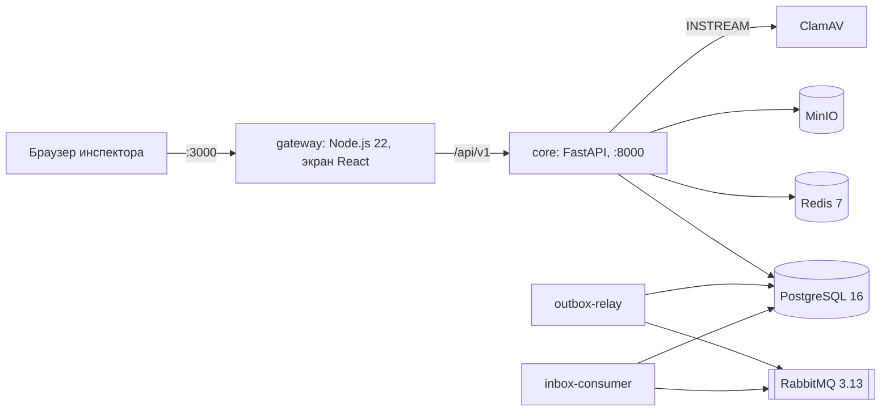

# Архитектура

Контур сверяет загруженные ПД, РД и ИД по матрице из 132 параметров и
отдаёт инспектору кандидатов с доказательствами. Решение по каждому
кандидату принимает инспектор. Проект со СНиП Контур не сверяет.

Три контура не складываются в один процент. Подробности —
[`TZ_SCORECARD.md`](TZ_SCORECARD.md) и [`METRICS.md`](METRICS.md).

| Контур | Что в нём | Сейчас |
|---|---|---|
| Code | Контракт, пайплайн, автотесты | 59 executable, 68 extractor_missing, 1 advisory, 4 source_missing |
| Acceptance | Пороги раздела 14 на frozen validation | не измерены. Гейты I/J/K/L открыты |
| Production | OIDC, TLS, живой РиН, УКЭП | вне этой поставки |

## Как идёт запрос

Пользователь открывает gateway (`:3000`). Он ограничивает размер тела,
частоту загрузки и отдаёт статику. Статусы находок он не пишет.

Ядро (`:8000`) проверяет JWT, роль и `object_id`. Загрузку проверяет ClamAV.
PDF разбирается в дочернем процессе. DOCX отдаёт абзацы и таблицы. XML
отдаёт текстовые узлы, без схемы пояснительной записки и без внешних
сущностей. Zip раскрывается в PDF, DOCX и XML. 7z, rar и DWG не становятся
тихим пропуском: 7z и rar — `ARCHIVE_NOT_EXPANDED`, DWG — `UNSUPPORTED_FORMAT`.

Дальше детерминированный путь:

1. Голова редакции по шифру штампа. Пустой шифр не прячет чужой том, а ПД
   и РД одного имени без метки редакции собирает в цепочку. Подробности —
   в разделе [«Редакция, штамп и знак триггера»](#редакция-штамп-и-знак-триггера).
2. Экстрактор правила читает текст страницы. Нет рабочего экстрактора —
   правило остаётся `extractor_missing` и нарушения не выдаёт. Сбой одного
   правила оставляет остальные строки.
3. Компаратор сравнивает значения. Расхождение — `CANDIDATE` с
   `evidence_group_id`, SHA-256, страницей и polygon. Нет документа стадии —
   `MISSING_EVIDENCE`, это не нарушение.
4. Инспектор подтверждает или отклоняет. Только он пишет
   `CONFIRMED_VIOLATION`. Отклонение требует причину. Пачкой подтверждаются
   только отмеченные `CANDIDATE`.

Протокол JSON, DOCX, XML и PDF собирается из одного решения. В РиН уходит
mock-очередь. Подтверждение брокера не является ACK РиН.

## Редакция, штамп и знак триггера

Шифр в основной надписи важнее имени файла. Имя не подменяет прочитанный
штамп.

На большом листе штамп — правый нижний угол 190×70 мм видимой страницы,
форма 1 ГОСТ Р 21.101, с учётом поворота `/Rotate`. Штамп читается с
первого листа документа. Из него берутся шифр комплекта (включая
обозначения через дефис, косую черту и точку вида `2451.П.ДР.ГИ.ТЧ`),
графа «Лист» и буква стадии: П, Р или И. У одностраничного документа с
пустой графой «Лист» и «Листов 1» номер листа равен 1; дробный номер `6,1`
приводится к `6.1`. Ссылки на ГОСТ, СП, сертификаты, номера экспертизы и
марки изделий шифром комплекта не становятся. Вложенная надпись выше угла
номер листа не подменяет. Подпись «Утвердил» вне угла лист не утверждает.
Второе чтение шифра берёт тот же первый лист.

Если штамп шифра пуст, проектная и рабочая стадии с одним именем
собираются в одну цепочку. Из ключа убираются «кор», «изм», «ред» и копия
«(1)». `КР1.pdf` и `КР1-кор3.pdf` — один том, голова — больший номер.
«Корректировка №4» на титуле — номер редакции и важнее номера в имени того
же файла.

Один номер у двух разных файлов — `CLARIFICATION_REQUIRED`. «Последний
загруженный» не выбирается. «Изм» и «кор» между собой не упорядочиваются.
Акты исполнительной документации по имени не схлопываются. Явная связь
predecessor остаётся сильнее имени. Единственная голова ПД без штампа
сравнивается с основанием `SOLE_HEAD`, штамп при этом не становится
утверждением. Явный «не утв.» эталоном не становится.

Размер на чертеже, записанный как 500×300, скалярное правило пропускает.
Произведение сторон остаётся у правила, которое само его просит. Сбой
одного правила оставляет остальные строки матрицы: у сбойного качество
низкое, нарушения нет.

Компаратор вычитает измерения десятичной дробью: 0,9 и 0,8 дают −0,1.
Текст триггера матрицы задаёт знак. «Уменьшение» и «понижение» не делают
кандидатом рост. «Увеличение» и «превышение» не делают кандидатом падение.
«Расхождение», «изменение» и «подмена» оставляют кандидата в любую сторону.
Противоположный знак — отсутствие срабатывания триггера, не
`NEGATIVE_VERIFIED`.

Помещения сравниваются по всем парам листов выше порога правила. Спор
одного номера гасит только его. Латинские B и P в метке читаются как В и П.

Повтор учебного комплекта повторяет идентификатор находки. Решение
инспектора пишется в последний процесс, где такой переход ещё допустим.
Повторный разбор того же процесса сохраняет решение, пока ожидаемое и
фактическое значения не изменились. Изменились — карточка снова кандидат.

Решения по редакции — [ADR-0003](adr/0003-revision-resolver-before-comparison.md),
[ADR-0015](adr/0015-missing-approval-is-clarification.md),
[ADR-0017](adr/0017-sole-head-without-stamp.md). Знак триггера, единицы и
невидимый текст — [`SOTA_AEROBIM_ANALYSIS.md`](SOTA_AEROBIM_ANALYSIS.md).

## Контейнеры стенда

| Сервис | Роль | Порт на `127.0.0.1` |
|---|---|---|
| `gateway` | Вход: 50 МБ на файл, 200 МБ на пакет, `RATE_LIMITED`, раздача экрана, `/metrics` по токену | `3000` |
| `core` | Разбор, сверка, API, протокол | `8000` |
| `postgres` | Процессы, находки, аудит, outbox и inbox | `5432` |
| `redis` | Кеш паспортов документов по SHA-256 файла | `6379` |
| `rabbitmq` | Брокер очереди в сторону РиН, метрики очереди | `5672`, `15672`, `15692` |
| `minio` | Тела загруженных файлов | `9000`, `9001` |
| `clamav` | Проверка загрузки | — |
| `outbox-relay` | Публикация финализированного протокола в брокер | — |
| `inbox-consumer` | Приём сообщений после commit | — |
| `storage-integrity` | Профиль `integrity`: сверка SHA-256 хранилища раз в сутки | — |
| `package-runner` | Профиль `runner`: пакетный прогон без сети | — |

Экран открывается наружу переменной `KONTUR_BIND=0.0.0.0`. Базы и брокер
остаются на loopback. Сервисы приложения работают от пользователя 10001 с
файловой системой только на чтение и `cap_drop: ALL`, базовые образы
закреплены digest.

## Где вердикт

Вердикт сравнения — код компаратора. Модель, если она появится, может
только предложить кандидата и черновик текста. Поле `finding_status` она
не пишет. Overlay нормы не меняет вердикт матрицы.

## Чего нет в прогоне приёмки

Внешние OCR, LLM и VLM. Облачный стенд по ссылке. Скрытый тест и подбор
порога по нему. Заявление, что все 132 параметра исполняются. Пять сессий
инспекторов. Промышленные OIDC, TLS, УКЭП и живой РиН.

Команда стенда и список «есть / дальше» — в [`README.md`](../README.md).
Пробелы — в [`KNOWN_GAPS.md`](KNOWN_GAPS.md).
